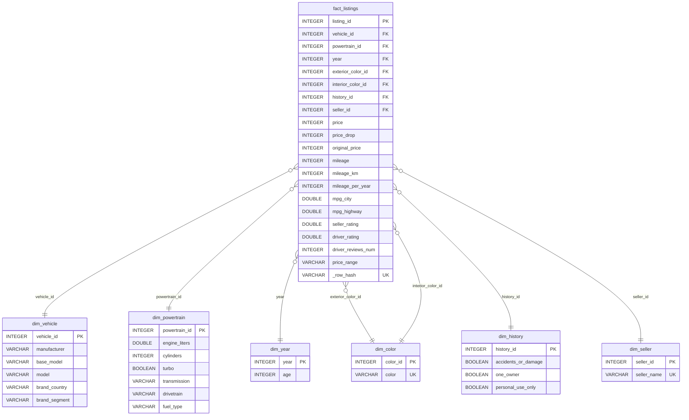

# Proyecto final — Fundamentos de Ingeniería de Datos

Pipeline completo **RAW → EXTRACTED → TRANSFORMED → SERVING** con datos de autos usados, más una app de Streamlit que usa esos datos.

> Este README es la bitácora del proyecto: aquí se documentan las decisiones y dónde está la evidencia de cada capa para armar el reporte. Se actualiza al terminar cada capa.

---

## 1. Propósito

| Elemento | Definición |
|---|---|
| **Pregunta** | ¿Cuánto vale un carro según sus características? |
| **Quién la usa** | Un agente de ventas que valúa autos, o una persona común que quiere saber cuánto vale su carro o el que piensa comprar |
| **Forma de respuesta** | **Las dos opciones** en una sola app: **Modelo** ("¿Cuánto vale mi carro?": formulario → precio estimado + métricas) y **Tablero** ("¿Cuánto vale el carro que quiero comprar?": gráficas con filtros) |
| **Variable objetivo** | `price` (precio en USD) |

## 2. Fuente de datos

| Etiqueta | Nombre | URL | Formato | Licencia |
|---|---|---|---|---|
| `autos` | Used Cars Dataset (Cars.com) | <https://www.kaggle.com/datasets/andreinovikov/used-cars-dataset> | CSV | CC0-1.0 |

**Por qué sirve:** son anuncios reales de venta al público (2023), con 762 091 filas de 30 marcas. Trae el precio y las características que determinan el valor de un auto: marca, modelo, año, millaje, motor, transmisión, tracción, combustible, rendimiento, accidentes, si tuvo un solo dueño y si fue de uso personal.

**Cómo se eligió:** [Codigos/BUSQUEDA.ipynb](Codigos/BUSQUEDA.ipynb).
- Primero se buscó en México y Latinoamérica, y se descartó: hay pocas filas, falta el kilometraje o son precios de referencia.
- Después se buscó en EE. UU. y se compararon 4 candidatos.

## 3. Decisiones de diseño

| Decisión | Justificación | Dónde |
|---|---|---|
| Muestra de **200 000 filas** | El CSV completo (unos 140 MB) supera el límite de 100 MB por archivo de GitHub. 200 000 filas bastan para el modelo y el tablero | INGESTA, PASO 2 |
| Muestra **estratificada por marca** con el método del mayor residuo | Cada marca conserva su proporción del mercado (diferencia máxima: 0.001 puntos porcentuales) | INGESTA, PASO 4 |
| Semilla fija `random_state=42` | La muestra es reproducible: siempre salen las mismas filas | INGESTA, PASO 4 |
| La muestra **no limpia nada** | RAW debe quedar crudo. La limpieza va en TRANSFORMACION | INGESTA, PASO 4 (verificación) |
| El CSV completo no se sube | Está en `.gitignore`. INGESTA lo vuelve a descargar de Kaggle si no existe | `.gitignore` |
| Control de cambios por **huella SHA-256** de cada fila | `raw_autos` no tiene fecha de publicación, así que no se puede usar marca de agua. La huella detecta filas nuevas o modificadas | EXTRACCION, PASOS 2 y 3 |
| Carga con `append` (no `replace`) | Conserva los lotes anteriores. El CDC evita duplicar filas | EXTRACCION, PASO 3 |
| `Exportaciones/` no se sube | El JSON de la comparación de formatos pesa 115 MB. EXTRACCION lo regenera | `.gitignore` |
| Nombres de columnas en inglés | El dataset es de EE. UU. Se conservan los nombres originales y las columnas nuevas siguen la misma convención | TRANSFORMACION |
| Precio válido de **$1,000 a $200,000** | Abajo hay precios simbólicos ($1, $299). Arriba hay errores ($1,111,111) y superdeportivos que el usuario no valúa y que distorsionarían el modelo | TRANSFORMACION 3.4 |
| Año válido de **2000 a 2024** | Los clásicos se aprecian con la edad, que es la lógica contraria a la del resto | TRANSFORMACION 3.4 |
| Se **eliminan** las filas con nulos en accidentes, un dueño y uso personal | Son entradas del formulario. Imputarlas metería ruido en variables clave | TRANSFORMACION 3.3 |
| Categorías y motor se **imputan** con la moda o la mediana de marca + modelo base | El modelo no acepta nulos, y los autos del mismo modelo comparten esas características | TRANSFORMACION 3.8–3.10 |
| Columnas del vendedor y de las reseñas: **solo informativas** | No son características del auto y el usuario no puede capturarlas. Se usan en el tablero, no en el modelo, y no se imputan | TRANSFORMACION 3.11 y roles en el lineage |
| `price_drop`, `original_price` y `price_range` fuera del modelo | Se derivan del precio o se conocen después de publicar. Usarlas sería *data leakage* | TRANSFORMACION 3.14 |
| Precio en **USD**, kilometraje también en km | El dataset es de EE. UU. Los km se agregan para usuarios en México | TRANSFORMACION 3.14 |
| Nombres de tablas en inglés | Consistentes con los nombres de columnas | MODELADO |
| Grano: **un anuncio de venta** | Es el nivel que necesitan el modelo (un precio por auto) y el tablero | MODELADO, PASO 2 |
| `seller_rating` y `driver_rating` en el hecho, no en una dimensión | No dependen solo de su llave: 2 070 vendedores tienen varias calificaciones | MODELADO, PASO 2 |
| `dim_color` de rol múltiple y `dim_history` como dimensión basura | Una sola lista de colores para exterior e interior. Las 3 banderas sí/no se juntan en 8 combinaciones | MODELADO 3.4 y 3.5 |
| `serving.db` se crea de nuevo en cada ejecución | DuckDB no libera el espacio de las tablas borradas: el archivo crecía (35 → 71 MB) | MODELADO, PASO 3 |
| El modelo se entrena desde `serving.db` (hechos + dimensiones) | Usa la misma capa que la app | MODELO_PREDICTIVO, PASO 1 |
| **Regresión lineal** sobre `log(price)` en lugar de árbol de decisión | El árbol es un poco más preciso (R² 0.912 contra 0.888), pero predice por escalones: en 49 de 300 autos sube el precio al agregar millas y en 197 de 222 ignora un accidente. La lineal siempre es coherente, se explica en % por variable y pesa 11 KB | MODELO_PREDICTIVO, PASOS 7, 10 y 11 |
| Se guarda el modelo entrenado con el 80 % | Las métricas que muestra la app son exactamente las de la prueba | MODELO_PREDICTIVO, PASO 11 |
| La app usa **km**, aunque los datos están en millas | Es para usuarios en México. La conversión a millas para el modelo es automática | `streamlit/app.py` |
| El formulario pide solo lo que el usuario sabe | Marca, modelo, año, km e historial. Motor, rendimiento y colores se prellenan con lo más común de ese modelo y año (opciones avanzadas) | `streamlit/app.py`, pestaña 1 |
| MODELADO copia `serving.db` a `streamlit/` | La app siempre usa la última versión del modelo de datos | MODELADO, último paso |
| Versiones fijas en `streamlit/requirements.txt` | El `.joblib` necesita la misma versión de scikit-learn, y `serving.db` la misma de DuckDB | `streamlit/requirements.txt` |

## 4. Mapa del flujo

```
Kaggle (andreinovikov/used-cars-dataset)
  │
  ▼  INGESTA.ipynb ................................................ RAW
  │    Datasets_raw/andreinovikov_used-cars-dataset/cars.csv            (completo, solo local)
  │    Datasets_raw/andreinovikov_used-cars-dataset/cars_muestra.csv    (200k filas)
  │    Base_de_datos/base_datos.db → raw_autos
  │
  ▼  EXTRACCION.ipynb ............................................. EXTRACTED
  │    Base_de_datos/base_datos.db → extracted_autos
  │    Extraccion_de_Datos/Logs/cdc_autos.json · Extraccion_de_Datos/Logs/extraccion_log.jsonl
  │
  ▼  TRANSFORMACION.ipynb ......................................... TRANSFORMED
  │    Transformacion_de_Datos/Processed/transformed_autos.parquet
  │    Transformacion_de_Datos/Logs/transformacion_log.jsonl · lineage_transformed_autos.json
  │    Transformacion_de_Datos/Reportes/bitacora_transformed_autos.csv · calidad_transformed_autos.csv
  │
  ▼  MODELADO.ipynb ............................................... SERVING
  │    Modelado_de_Datos/serving.db (DuckDB): fact_listings + 6 dimensiones
  │    Modelado_de_Datos/Reportes/validacion_serving_autos.csv
  │
  ▼  MODELO_PREDICTIVO.ipynb ...................................... MODELO
  │    streamlit/modelo.joblib · streamlit/modelo_info.json · streamlit/real_vs_predicho.png
  │
  ▼  streamlit/app.py ............................................. USO
       tablero (consulta serving.db) + formulario de predicción (modelo.joblib)
```

## 5. Evidencias por capa

### RAW — [Codigos/INGESTA.ipynb](Codigos/INGESTA.ipynb) 

| Evidencia | Valor | Dónde |
|---|---|---|
| Tabla de metadatos de la fuente | Etiqueta, nombre, URL, formato y licencia | PASO 2 |
| Filas y columnas del dataset completo | 762 091 × 20 | PASO 3 |
| Filas y columnas ingestadas (muestra) | **200 000 × 20** | PASOS 5 y 6 |
| Proporción por marca: completo vs. muestra | Diferencia máxima de 0.001 puntos porcentuales | PASO 4 |
| La muestra es una copia fiel | Mismas columnas, mismos tipos y filas idénticas a su original | PASO 4 |
| La tabla en SQLite es igual al CSV | Mismas 200 000 filas y 20 columnas | PASO 6 |
| Tamaño de `cars_muestra.csv` | 36.6 MB | PASO 4 |
| Tamaño de `base_datos.db` (solo `raw_autos`) | 35.6 MB | PASO 6 |

**Problemas de calidad detectados en RAW**, que se tratarán en TRANSFORMACION:
- Precios imposibles: desde 1 USD hasta más de 2 millones.
- Años desde 1915.
- Columnas con muchos nulos: `price_drop` (46 %), `seller_rating` (28 %) y `mpg` (18.5 %).
- Texto sin estandarizar en `transmission`, `fuel_type` y los colores.
- La versión del auto viene mezclada en `model` (por ejemplo, "ILX Hybrid 1.5L").

### EXTRACTED — [Codigos/EXTRACCION.ipynb](Codigos/EXTRACCION.ipynb) 

| Evidencia | Valor | Dónde |
|---|---|---|
| Filas RAW vs. EXTRACTED | **200 000 = 200 000** (extracción completa) | PASO 5 |
| Columnas | 20 originales + 4 de metadatos (`_batch_id`, `_extracted_at`, `_source_table`, `_row_hash`) = **24** | PASO 5 |
| Control de cambios, 1.ª ejecución | `full_load`: 200 000 filas leídas, **200 000 nuevas**, lote 1 | PASO 4.1 |
| Control de cambios, 2.ª ejecución | `incremental`: 200 000 filas leídas, **0 nuevas**. La tabla no crece | PASO 4.2 |
| Estado del CDC | `Extraccion_de_Datos/Logs/cdc_autos.json` | PASO 4 |
| Log de auditoría | `Extraccion_de_Datos/Logs/extraccion_log.jsonl`, 2 operaciones exitosas | PASO 6 |
| Metadatos completos | 0 nulos en los 4 metadatos | PASO 5 |
| Tamaño de `base_datos.db` (raw + extracted) | 80.9 MB | PASO 5 |
| Comparación de formatos | CSV 45.9 MB · JSON 115 MB · **Parquet 7.7 MB**. Solo Parquet conserva todos los tipos de dato | PASO 7 |

**Hallazgo para TRANSFORMACION:** hay 199 388 huellas distintas en 200 000 filas. Es decir, **612 filas son duplicados exactos** (610 anuncios repetidos).
### TRANSFORMED — [Codigos/TRANSFORMACION.ipynb](Codigos/TRANSFORMACION.ipynb) 

| Evidencia | Valor | Dónde |
|---|---|---|
| Filas EXTRACTED → TRANSFORMED | 200 000 → **189 845** (se conserva el 94.9 %). La bitácora cuadra con las 10 155 filas eliminadas | PASO 4 |
| Columnas | 20 de negocio → **37** (31 de negocio + 6 metadatos) | PASO 5 |
| Bitácora con justificación | 30 registros (15 transformaciones) → `Reportes/bitacora_transformed_autos.csv` | PASO 3 y 6 |
| Calidad antes vs. después | `Reportes/calidad_transformed_autos.csv` | PASO 4 |
| Lineage con roles de columnas | `Logs/lineage_transformed_autos.json` | PASO 6 |
| Tipos conservados en Parquet | 37 de 37 iguales | PASO 5 |
| Tamaño del Parquet | 8.7 MB | PASO 5 |

**Calidad antes vs. después:**

| Métrica | Antes | Después |
|---|---|---|
| Filas | 200 000 | 189 845 |
| Celdas nulas en columnas del auto | 186 091 | **0** |
| Celdas nulas informativas (se dejan nulas a propósito) | 66 819 | 57 441 |
| Duplicados exactos | 612 | 1* |
| Precio fuera de rango | 377 | **0** |
| Año fuera de rango | 1 536 | **0** |
| Millaje nulo o fuera de rango | 135 | **0** |
| Variantes de transmisión | 696 | **3** |
| Variantes de tracción | 28 | **4** |
| Variantes de combustible | 23 | **7** |
| Variantes de color exterior / interior | 4 732 / 2 705 | **15 / 14** |
| Eléctricos con cilindros | 37 | **0** |

\* Son dos anuncios distintos que quedaron iguales al estandarizar las categorías. No es un anuncio repetido.

**Transformaciones principales:**
- Se eliminaron:
  - 612 duplicados;
  - 125 filas sin millaje;
  - 8 190 filas con nulos en accidentes, un dueño o uso personal;
  - 326 precios fuera de rango;
  - 893 autos anteriores a 2000;
  - 9 millajes de relleno.
- `model` pasó de 7 289 valores a **605 modelos base**. El texto completo se conserva como versión.
- Del motor se extrajeron la cilindrada, los cilindros y el turbo. A los eléctricos se les asignó 0 cilindros.
- `mpg` se separó en ciudad y carretera.
- Se unió un catálogo de 30 marcas con su país y su segmento (lujo o masiva).
- Columnas derivadas: `age`, `mileage_per_year`, `mileage_km`, `original_price` y `price_range`.
### SERVING — [Codigos/MODELADO.ipynb](Codigos/MODELADO.ipynb) 

**Esquema estrella** en `Modelado_de_Datos/serving.db` (DuckDB, 35.8 MB). Grano: un anuncio de venta.



| Tabla | Filas | Llave | Concepto |
|---|---|---|---|
| `fact_listings` | 189 845 | `listing_id` | Hechos: medidas, medidas informativas y atributos degenerados |
| `dim_vehicle` | 7 292 | `vehicle_id` | Desnormalizada: incluye la marca, su país y su segmento |
| `dim_powertrain` | 752 | `powertrain_id` | Motor, transmisión, tracción y combustible |
| `dim_year` | 24 | `year` (natural) | Año y antigüedad |
| `dim_color` | 15 | `color_id` | **Rol múltiple**: el hecho la usa para el color exterior y el interior |
| `dim_history` | 8 | `history_id` | **Dimensión basura**: accidentes, un dueño, uso personal |
| `dim_seller` | 16 897 | `seller_id` | Informativa (solo tablero) |

**Validación** (`Modelado_de_Datos/Reportes/validacion_serving_autos.csv`): **14 de 14 correctas**.

| Validación | Tabla plana | Esquema estrella |
|---|---|---|
| Filas | 189 845 | 189 845 |
| Suma de `price` | 6 075 021 861 | 6 075 021 861 |
| Suma de `mileage` | 10 585 531 210 | 10 585 531 210 |
| Suma de `price_drop` | 103 032 746 | 103 032 746 |
| `seller_rating` / `driver_rating` no nulos | 139 583 / 182 666 | 139 583 / 182 666 |
| Huérfanas, en cada una de las 7 llaves foráneas | — | **0** |
| Reconstrucción de la tabla plana (31 columnas, `EXCEPT ALL` en ambos sentidos) | — | **0 filas distintas** |

**Hallazgos de las consultas de prueba:**
- Un auto de lujo pierde alrededor del 50 % de su valor en 4 años ($64,995 → $35,882). Uno de marca masiva pierde alrededor del 38 % ($41,836 → $25,995).
- Un auto con accidentes y varios dueños tiene un precio mediano de $18,529. Uno sin accidentes y con un solo dueño tiene $32,999. La antigüedad también influye: 7 contra 3 años.
### MODELO — [Codigos/MODELO_PREDICTIVO.ipynb](Codigos/MODELO_PREDICTIVO.ipynb) 

**Variables de entrada (20):**
- Categóricas: marca, modelo base, país y segmento de la marca, transmisión, tracción, combustible, colores exterior e interior.
- Numéricas: antigüedad, millaje, millas por año, cilindrada, cilindros, rendimiento en ciudad y en carretera.
- Sí/no: turbo, accidentes, un dueño, uso personal.

**Excluidas:**
- Redundantes: `model` (la versión), `year` y `mileage_km`.
- Por *data leakage*: `price_drop`, `original_price` y `price_range`.
- Informativas: las del vendedor y las reseñas.

Partición: 80 % entrenamiento (151 876 anuncios) y 20 % prueba (37 969 anuncios), con `random_state=42`.

| Métrica (prueba) | Regresión lineal  | Árbol de decisión (profundidad 18) |
|---|---|---|
| R² prueba / entrenamiento | **0.888 / 0.887** | 0.912 / 0.960 |
| MAE | $3,654 | $3,340 |
| RMSE | $6,455 | $5,727 |
| MAPE | 11.6 % | 11.5 % |
| Tamaño `.joblib` | **11 KB** | 0.6 MB |
| +20k millas **sube** el precio (de 300 autos) | **0** | 49 |
| Un accidente **no baja** el precio (de 222 autos) | **0** | 197 |

**Efecto de cada variable en el precio (regresión lineal):**
- Cada desviación estándar de antigüedad le resta **22 %** al precio, y la de millaje le resta **16.3 %**.
- Un accidente le resta **4 %**.
- El turbo le suma **12.6 %**, y cada desviación estándar de cilindrada le suma **14.9 %**.

**Ejemplo:** un Toyota RAV4 de 4 años con 45 000 millas se estima en **$29,123**. La mediana real de 155 anuncios parecidos es $30,451.

**Archivos en `streamlit/`:**
- `modelo.joblib` (11 KB): el `Pipeline` completo, con la preparación y la regresión.
- `modelo_info.json`: las variables, las métricas y las versiones de las librerías.
- `real_vs_predicho.png`.

### Uso de los datos — [streamlit/app.py](streamlit/app.py) 

App **"¿Cuánto vale mi carro?"**: tiene el banner institucional, el banner de la app y 3 pestañas. Todas las consultas leen `serving.db` uniendo `fact_listings` con sus dimensiones.

| Pestaña | Responde | Contenido |
|---|---|---|
| 🚗 **¿Cuánto vale mi carro?** (modelo) | Cuánto vale el auto del usuario | **Formulario:** marca → modelo → año, km, accidentes, dueños y uso. **Opciones avanzadas** prellenadas con lo más común del modelo: motor, transmisión, tracción, combustible, rendimiento y colores. **Resultado:** precio estimado, rango (± MAPE) y comparación con anuncios reales parecidos. **Gráfica:** el auto del usuario (◆) frente a los anuncios reales de ese modelo |
| 🔎 **¿Cuánto vale el carro que quiero comprar?** (tablero) | Cuánto cuestan los autos que le interesan | **Filtros:** presupuesto, año, km máximo, segmento, marcas y combustible. **Indicadores:** anuncios, precio mediano, km mediano y % con rebaja. **4 gráficas:** (1) depreciación por antigüedad, (2) modelos más ofrecidos, (3) precio por tramo de km de un modelo, (4) efecto de accidentes y dueños. **Tabla:** vendedores mejor calificados (solo informativa) |
| 📊 **Sobre el modelo** | Qué tan confiable es la estimación | Métricas (R², MAE, MAPE, RMSE), gráfica de real contra predicho, efecto en % de cada variable, cómo funciona y limitaciones |

**Pruebas realizadas:**
- Con `AppTest` de Streamlit:
  - las 3 pestañas sin errores;
  - las **30 marcas** en el formulario;
  - un eléctrico (Tesla Model 3);
  - filtros sin resultados (muestra un aviso y el resto de la app sigue funcionando).
- **Prueba de "otra computadora":**
  - se copió solo la carpeta `streamlit/` a otra ubicación;
  - se creó un entorno de Python **nuevo**;
  - se instaló únicamente `streamlit/requirements.txt`;
  - se ejecutó `streamlit run app.py`. El servidor respondió y la app corrió sin errores.

**Pendiente para el reporte:** capturas de pantalla de cada pestaña.

## 6. Estructura del repositorio

```
├── Codigos/
│   ├── BUSQUEDA.ipynb          ← selección del dataset
│   ├── INGESTA.ipynb           ← RAW
│   ├── EXTRACCION.ipynb        ← EXTRACTED
│   ├── TRANSFORMACION.ipynb    ← TRANSFORMED
│   ├── MODELADO.ipynb          ← SERVING
│   ├── MODELO_PREDICTIVO.ipynb ← regresión lineal vs. árbol → streamlit/modelo.joblib
│   ├── ALMACENAMIENTO.ipynb    ← (actividad anterior, por confirmar con el profesor)
│   └── SQL_CONSULTAS.ipynb     ← (actividad anterior, por confirmar con el profesor)
├── Utilidades/
│   ├── utils.py                ← rutas y funciones compartidas
│   └── generar_banner.py       ← genera streamlit/banner.png
├── Ingesta_de_Datos/
│   ├── Datasets_raw/andreinovikov_used-cars-dataset/cars_muestra.csv
│   └── Base_de_datos/base_datos.db     ← raw_autos, extracted_autos
├── Extraccion_de_Datos/
│   ├── Logs/cdc_autos.json
│   ├── Logs/extraccion_log.jsonl
│   └── Exportaciones/              ← comparación de formatos (no se sube)
├── Transformacion_de_Datos/
│   ├── Processed/transformed_autos.parquet
│   ├── Logs/transformacion_log.jsonl
│   ├── Logs/lineage_transformed_autos.json
│   ├── Reportes/bitacora_transformed_autos.csv
│   └── Reportes/calidad_transformed_autos.csv
├── Modelado_de_Datos/
│   ├── serving.db                  ← esquema estrella (DuckDB)
│   └── Reportes/validacion_serving_autos.csv
├── streamlit/                      ← todo lo necesario para ejecutar la app en otra computadora
│   ├── app.py
│   ├── serving.db                  ← copia de Modelado_de_Datos/serving.db
│   ├── requirements.txt
│   ├── modelo.joblib               ← regresión lineal (11 KB)
│   ├── modelo_info.json
│   ├── banner.png                  ← generado con Utilidades/generar_banner.py
│   ├── banner_profesor.png
│   └── real_vs_predicho.png
├── Privado/                    ← credenciales (no se sube)
└── requirements.txt
```

## 7. Cómo ejecutar

```bash
py -3.13 -m venv .venv
.venv\Scripts\activate
pip install -r requirements.txt
```

1. Copia tu `kaggle.json` a `Privado/` (ver [Privado/LEEME.md](Privado/LEEME.md)).
2. Ejecuta los notebooks de `Codigos/` en orden: INGESTA → EXTRACCION → TRANSFORMACION → MODELADO → MODELO_PREDICTIVO.
   - `BUSQUEDA.ipynb` es opcional: solo documenta cómo se eligió el dataset.

### Ejecutar solo la app

La carpeta `streamlit/` funciona sola: no necesita los notebooks ni el resto del proyecto.

```bash
cd streamlit
py -3.13 -m venv .venv
.venv\Scripts\activate
pip install -r requirements.txt
streamlit run app.py
```


